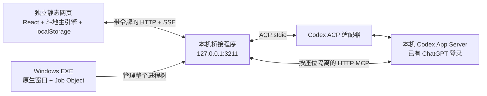

# 同桌 · Agent Arcade

人与本机 agents 一起玩游戏。首版实现斗地主。

源码：[IanYet/agent-game](https://github.com/IanYet/agent-game) · 网页：[同桌 · Agent Arcade](https://ianyet.github.io/agent-game/) · Windows EXE：[GitHub Releases](https://github.com/IanYet/agent-game/releases/latest)。

这是两个独立交付物：

- **静态 Web app**：浏览器执行所有游戏规则，状态与牌谱存在 localStorage；可以放到任意静态托管服务。没有游戏后端、数据库或远程加入功能。
- **Windows 本地连接器**：单文件、免安装的 `同桌连接器.exe`。提供原生状态窗口，自带运行时；不托管网页、不自动打开浏览器。通过 ACP 适配器连接本机已有的 Codex，复用 ChatGPT 订阅登录。

## 使用

1. 在浏览器打开游戏网站。
2. 下载并双击连接器 EXE，等待「已就绪」。Releases 文件名为 `tongzhuo-connector-windows-x64.exe`，本地打包名为 `同桌连接器.exe`。不需要安装 Node.js，也不需要解压。
3. 网页点击 **连接 Codex**；如果浏览器询问本地网络权限，允许它访问本机连接器。
4. 创建斗地主牌桌，选择 1 位真人 + 2 位 agents，或 3 位 agents 观战。
5. 最小化或关闭窗口会缩到 Windows 右下角托盘，游戏继续运行。双击托盘图标或在菜单选择「显示窗口」可恢复；选择「退出连接器」才会退出。Windows 会结束它的所有子进程，包括 Node、ACP 适配器、Codex App Server 和工具宿主，并释放监听端口。
6. 在连接器窗口或托盘菜单选择「检查更新」。发现更新后点击「下载更新」，默认浏览器会打开 GitHub 最新 Windows EXE 的下载链接。下载后退出旧连接器，再双击新 EXE。

Windows 10/11 x64；本机需要安装 Codex，并用 ChatGPT 订阅登录。EXE 使用 Windows 自带的 .NET Framework 4.8。当前开发版本未做代码签名。

模型选择来自本机 Codex 的 `model/list`，不硬编码模型或假定订阅可访问某个模型。模型目录不代表账户权益，实际推理成功才确认该次调用可用。真实 agent 对弈会消耗 Codex 订阅额度。

## 开发

开发环境使用 Node.js 22+。这项要求只适用于源码开发；最终 EXE 包含独立运行时。

```powershell
npm install
npm run dev
```

网页：`http://127.0.0.1:5173`；独立连接器：`http://127.0.0.1:3211`。

也可以分别运行 `npm run dev:web` 和 `npm run dev:connector`。网页与连接器之间没有 Vite 代理；生产构建与开发环境均通过跨源协议直接连接 loopback。

```powershell
npm test
npm run typecheck
npm run check:codex
npm run build
npm run package:windows
npm run test:windows
```

- `dist/client/`：完整静态网站，部署整个目录即可。
- `dist/connector/`：连接器的构建中间产物。
- `release/同桌连接器.exe`：最终单文件 Windows 应用。
- `package:windows` 使用 Windows 自带的 C# 编译器生成原生窗口启动程序，把运行时与桥接程序作为资源嵌入 EXE；所有许可证一起嵌入。
- 正式网页从 GitHub Releases 下载单文件 EXE。本地构建还支持静态分片，浏览器拼接并校验 SHA-256 后保存为正常 EXE，以适配其他静态 CDN 的单文件大小限制；不需要下载后手动合并。

构建发布顺序为 `build` → `package:windows` → 部署 `dist/client`。打包后，下载清单及分片同时写入 `apps/web/public/downloads/` 与 `dist/client/downloads/`。它们是忽略的构建产物。

## 独立部署与来源配置

GitHub Pages 使用 `.github/workflows/pages.yml`：每次推送到 `main`，Windows runner 自动测试、构建网页、打包单文件 EXE，再将纯静态的 `dist/client/` 发布到 Pages。仓库 Settings → Pages 的 Source 选择 **GitHub Actions**。网页连接前会同时校验连接器版本系列、最低补丁版本与通信协议。不兼容时阻止握手，并显示检测版本、所需版本和最新连接器下载按钮；升级后可直接重新连接。网页下载按钮通过 `VITE_CONNECTOR_DOWNLOAD_URL` 指向最新 GitHub Release；每次构建的 EXE 也保存在 Actions 的 `windows-connector-x64` artifact 中。发布新版本时，将验证过的 EXE 以 `tongzhuo-connector-windows-x64.exe` 文件名上传到对应 Release 即可。

Vite 的资源与下载路径支持仓库子路径。工作流使用 Pages 返回的 `base_path`；本地构建默认相对路径，也可用 `PAGES_BASE_PATH=/agent-game/` 显式指定。

连接器仅绑定 `127.0.0.1`，默认端口 `3211`。它校验 Host 和网页 Origin，没有通配 CORS。

如果自行部署网站，在 `connector.config.json` 的 `allowedOrigins` 中加入网站完整 origin（协议 + 域名 + 非默认端口），重新打包连接器即可。也可以把该配置文件放在 EXE 旁边作为覆盖配置。默认包含本地开发、预览与本项目的静态站点来源。

高级环境变量：

| 变量 | 用途 |
| --- | --- |
| `CODEX_PATH` | 指定本机 `codex.exe` 或 npm 安装的 `codex.js` |
| `CODEX_ACP_PATH` | 指定兼容 ACP v1 且支持 HTTP MCP 的适配器 |
| `AGENT_GAME_WEB_ORIGINS` | 以逗号分隔的可信网页来源，覆盖配置文件 |
| `AGENT_GAME_DATA_DIR` | 指定连接器的隔离工作目录；不保存牌局 |
| `AGENT_GAME_PORT` | 开发或测试时更改连接器端口；网页默认仍连接 3211 |

运行时按内容哈希自动展开到系统临时目录 `AgentArcade/runtime-*`，可重复使用；无需安装程序或修改注册表。隔离工作目录默认在 `%LOCALAPPDATA%/AgentArcade/sessions`。Codex 的登录状态与会话存储继续由 Codex 自己管理，连接器不读取或复制凭据文件。

## 架构



Web app 拥有权威游戏状态。轮到 agent 时，网页让连接器唤醒对应会话；agent 发起 MCP 工具调用，连接器把调用转发到网页，网页校验行动、更新状态，再把工具结果送回。每局每个 agent 首次行动时创建独立会话，回合之间保留上下文。暂停只中断正在进行的行动，继续时复用原会话；暂停后可以按玩家分别修改模型与思考强度，下一次行动生效。一轮唤醒只能成功行动一次。

MCP 工具：

| 工具 | 能力 |
| --- | --- |
| `game_get_state` | 自己的手牌、其他玩家余牌数、公开历史、revision 与部分合法行动 |
| `game_legal_actions` | 分页获取合法行动及 actionId |
| `game_act` | 用最新 revision 和 actionId 执行本座位的一次行动 |
| `game_rules` | 当前规则及计分说明 |

每个座位拥有独立、仅存于连接器内存的 MCP capability token。工具不接受任意 seat 参数。过期凭据、非自己回合、重复行动、过期 revision、非法牌型均被拒绝。叫分时不披露底牌。只有本局结束才向界面公开剩余手牌。

网页刷新或 SSE 断开时，本机连接器停止玩家任务；网页恢复 localStorage 时默认暂停，需要主动继续。认证令牌不写入 localStorage。不同网页不能同时接管同一个连接器，不提供邀请或远程加入入口。

## Codex 接入说明

开局可以选择 **保留玩家对话到本机 Codex 历史**，默认关闭。关闭时，ACP 与原生模式均创建临时线程，结束后不写入 Codex 对话历史；开启后保存线程，并命名为「同桌 · 斗地主 · 玩家 · 第 N 局 · 牌局编号」。牌桌的「玩家设置」可查看和复制会话 ID。保存到本机历史不等于自动登记到 Codex 桌面客户端侧栏；当前 ACP 的线程来源标为 `vscode`，还使用独立 provider，客户端可能按来源、项目或 provider 筛选。

开局时每个座位分别选择 Harness、模型与思考强度，允许同桌混用当前已接入的 Codex ACP 与 Codex App Server。模型目录按 Harness 分开；当前两种 Codex 适配器都读取本机 Codex `model/list`。不支持的组合会明确拒绝，不会静默改成 `low`。暂停后修改模型与思考强度会作用于原会话的下一次行动；切换 Harness 需要新建牌桌。新牌桌或下一局重新创建会话，下一局沿用各位玩家的配置。

Claude Code、WorkBuddy 等其他 Harness 尚未实现适配，暂时不能加入同桌。新增适配器需要提供各自的会话、模型目录、行动与中断能力，再接到按座位路由的边界中；网页不会将 Codex 的模型目录用于其他 Harness。

ACP 标准当前没有临时会话字段。本项目构建时为固定版本的 `codex-acp` 添加受检查的小扩展，通过请求 `_meta.agentArcade.ephemeral` 转发到官方 `thread/start.ephemeral`，并禁止临时会话的自动命名。扩展只存在于连接器打包副本中，不改动 node_modules、本机 Codex 安装或全局设置。更换外部 ACP 适配器时，若不支持该扩展且未开启保留，会明确报错，避免意外保存对话。开发启动脚本会先生成扩展副本。

ACP 与 Codex App Server 是两种协议。默认 `Codex · ACP` 使用 `@agentclientprotocol/codex-acp`，适配到本机现有 Codex 可执行文件；另有 `Codex · App Server` 原生适配器。这里创建的是本机 harness 会话，不是通过 UI 自动化操纵桌面 App。

游戏会话采用只读沙箱，关闭 shell、浏览器、插件、子 agent、hooks 与无关 MCP 服务；这些覆盖只作用于本次进程与线程，不修改用户的全局 Codex 配置。订阅认证继续完全由 Codex 处理，不要求 API Key。

本机验证遇到默认 WebSocket 推理连接反复重试，因此游戏使用独立的 `agent_arcade_chatgpt` provider 配置，关闭 WebSocket，保留 Codex 的 ChatGPT 认证与认证模式对应的默认 endpoint，不自行指定或调用私有地址、不提取 OAuth token。这个 provider 名称避开新版本 Codex 保留的内置 provider ID。

参考：[OpenAI App Server 文档](https://learn.chatgpt.com/docs/app-server)、[OpenAI 认证说明](https://learn.chatgpt.com/docs/auth)、[provider 默认地址规则](https://learn.chatgpt.com/docs/enterprise/roll-out-a-gateway)、[Codex ACP 适配器](https://github.com/agentclientprotocol/codex-acp)、[ACP 会话与 MCP](https://agentclientprotocol.com/protocol/v1/session-setup)、[浏览器本地网络权限](https://developer.chrome.com/blog/local-network-access)。

## 验证与边界

普通测试不使用订阅推理。它们包含牌型、比较、100 局自动对弈、手牌隔离、叫分、春天计分、状态恢复、真实 HTTP MCP 整局联调、重复行动拒绝、来源校验、断线与凭据撤销。

`test:windows` 针对最终 EXE，创建一个真实但不开始推理的 ACP/Codex 玩家会话，随后分别测试正常退出和**仅强制结束 EXE 本身**。检查所有子进程消失、监听端口可以重新绑定、相同端口可以立即重启。强制退出测试不使用 `taskkill /T`，避免掩盖进程树管理错误。

需要主动进行真实订阅推理时运行：

```powershell
npx tsx scripts/smoke-game.ts
npx tsx scripts/smoke-game.ts --native
```

默认 smoke 检查三位独立玩家的叫分与合法出牌；它会消耗订阅额度，完成后自动停止会话。真实对局耗时和成功率仍取决于本机 Codex 版本、网络与账户限制；失败时会暂停并显示错误。

首版只实现斗地主；规则变体详见网页规则。新牌桌、下一局、网页刷新或重启连接器后会新建玩家会话；同局暂停继续不重建。未完成的浏览器牌局可以恢复，但刷新或重启后不自动接管旧 agent 对话。尚未提供代码签名、自动更新或 Windows ARM64 构建。

后续游戏扩展 `packages/game-core` 中的 `GameDefinition` 与目录；后续 harness 实现连接器的 `HarnessAdapter`。浏览器桥接协议集中在 `packages/protocol`，不依赖某个模型厂商。
