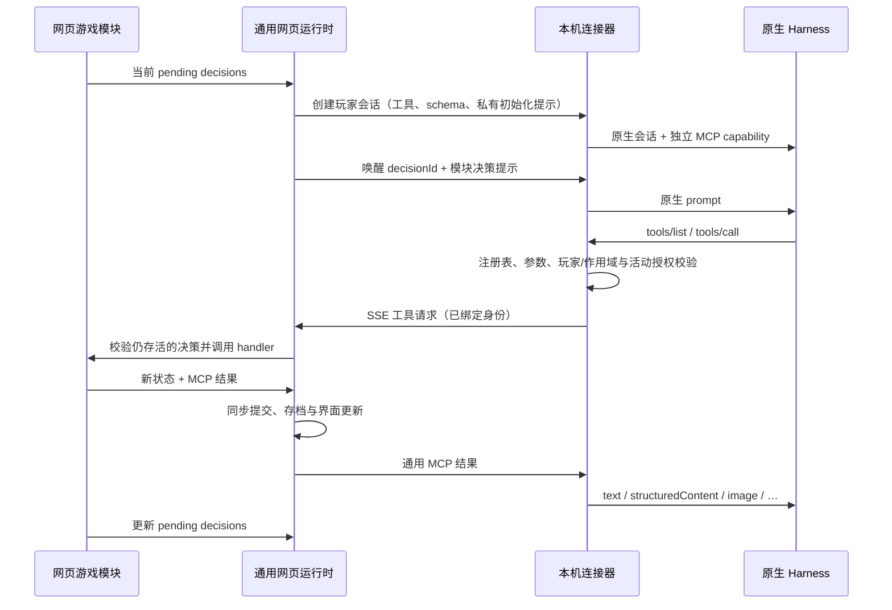

# 架构与数据流

## 四层边界

| 层 | 源码 | 拥有的职责 |
| --- | --- | --- |
| 游戏模块 | `apps/web/src/games/<id>/` | 元数据、人数与配置规则、引擎、私有观察、工具/schema/handler、提示词、完成条件、会话策略、场景/行动/公开记录界面、当前状态格式 |
| 通用网页运行时 | `apps/web/src/controller.ts`、`runtime/types.ts` | 稳定身份、决策调度、串行提交、真人输入、超时、暂停、会话管理和浏览器存档 |
| 独立协议与桥 | `packages/protocol`、`apps/connector/src/{bridge,mcp,server}.ts` | 会话工具注册、JSON Schema 校验、身份/作用域/决策绑定、HTTP/SSE/MCP 转发 |
| Harness | `apps/connector/src/harness/` | 原生进程/会话、模型与强度目录、认证、取消、MCP 挂载及动态工具白名单 |

`packages/game-core` 现在只是共享牌数据、牌堆与规则错误类型；斗地主和德州引擎、规则及测试位于各自模块目录。规则引擎只接收 `human/agent` 控制标记；固定的 Codex/dsh/WorkBuddy 标识属于平台层。

协议、桥和 Harness 都不导入具体游戏。运行时不读取牌、筹码、下注轮或游戏内 revision。中央 App、设置和历史页面通过注册表取得模块界面和摘要，没有逐游戏分支。

网页是权威状态持有者。连接器看不到可执行的模块实现，不下载或运行网页脚本；它只接收声明数据与提示词。用户浏览器与本机 Harness 之间无需云端游戏服务。

公共界面使用 React DOM，菜单与弹窗保留浏览器焦点和键盘语义。大厅由一个 Three.js 绘制器输出玻璃、首屏字形与局部透镜。CPU 光路和 GPU 表面共用几何；GSAP 编排游戏画廊，镭射卡共用 Canvas 绘制源供画面和透镜使用。游戏页保留公共区域透镜，只在真人主卡和操作区关闭透镜。所有玩家的状态光效共用 WebGL2 绘制器。

牌桌下层是独立的三维背景：德州使用六种颜色、带四种花色纹路的筹码，斗地主使用带倒角的四种花色模型，山东保皇使用金冠、侍卫盾徽、平民徽章与皇牌。游戏专属模型在对应游戏目录实现，由公共 TableModels 注册和释放。模型由 Three.js 几何生成，cannon-es 计算物件之间及边界的刚体碰撞。每个花色用一至四个凸块描述花瓣和柄，筹码使用圆柱碰撞体。物件之间有轻微引力，无人推动时会缓缓聚拢；画面横向中央、距顶部 20% 的位置还有柔和的吸引中心，让被推到操作区下方的物件缓缓回到上方，越靠近吸引中心，回引力越弱。

璀璨宝石的大厅卡由程序绘制红色切面红宝石；桌面采用模块内的六类三维宝石与黄金 token，包含厚边、环形纹样、凸起切面与各色材质。公共模型类仅委派模型的创建与释放，沿用现有物理和鼠标推动；WebGL 不可用时显示对应的静止宝石 token。

鼠标推动按屏幕上的移动路径检测，并向碰到的刚体施加冲量，不受物件所在深度限制。保留浏览器合并的输入采样，在两次物理更新之间也检查整段扫过路径；同一物件每次更新取最强的一次推动，避免高采样率鼠标产生过强的力。按钮、输入和玩家卡片区域不推动背景，透明标题与空白区域可以推动；鼠标停留时也会将靠近的物件轻轻排开。

背景直接绘制到页面的 WebGL 画布，透镜只截取指针周围的区域，不再逐帧复制整个屏幕。物理按 60 Hz 推进，画面跟随屏幕刷新并插值，上限为 60 FPS；限制绘制像素总量与物件数量，聚拢稳定后让刚体休眠并停止背景帧任务。弹窗打开或页面隐藏时暂停；减少动态与静态画面保留当前帧；WebGL 不可用时显示静止花色，卸载时释放几何、材质、纹理和绘制器。

开发模式下，背景画布和 `.cursor-lens` 的 `data-profile` 保存最近 360 个样本的平均耗时、P95 和最大值，每秒更新一次。物理细分为引力、鼠标推动、碰撞筛选、接触检测、约束和求解；绘制细分为变换同步、CPU 提交、GPU 执行及透镜页面合成、取样和拷贝。GPU 时间通过异步计时查询取得，浏览器不支持时明确标记不可用，不以 CPU 提交时间代替。

国际象棋的三维背景由游戏目录内的模型集合提供王、后、车、象、马、兵，以复合碰撞体接入公共物理场景；无 WebGL 时显示对应的棋子字形。游戏操作、棋谱和 Agent 工具共用 chess.js 走子引擎，和棋申请、自动结束与跨局计分由国际象棋模块处理。

## 身份与决策

| 标识 | 生命周期 |
| --- | --- |
| `playerId` | 玩家稳定身份；控制方式、名称或座位变化不改变它 |
| `kind/model/reasoningEffort` | 平台控制设置，不是规则身份 |
| `roomId` | 同一桌/房间；新桌生成新 ID |
| `runId`、`index` | 一手/一局/一轮；由平台生成，领域名称由模块解释 |
| `scopeId` | 会话授权范围，按模块策略取 roomId 或 runId |
| `decisionId` | 模块定义的待完成决策 ID |
| Harness `sessionId` | 原生进程或线程返回的会话 ID，与上述身份独立 |

模块返回决策集合 `{decisionId, actorId, allowedTools?, deadline?}[]`。一个玩家同时只运行一个原生 prompt，不同玩家可以并发。斗地主与德州返回单个行动者；同时决策的游戏可以返回多个参与者。

模块通过移除对应决策表示完成。一个决策可以调用多个工具、修改草案多次再确认；Agent 结束 prompt 后该决策仍存在，平台就暂停并报告未完成。平台没有「必须成功调用恰好一次 game_act」的假设。

工具参数不能提供可切换的玩家、scope 或 decision 身份。桥从 capability 与当前原生任务绑定它们；网页再校验该 actor 的 decision 仍在集合中。模块自己的行动参数可以包括业务 revision，但平台不以全局 revision 使其他并行决策失效。

## 串行提交与超时

`handleTool` 和 `humanAction` 是同步状态转换。工具入参校验、存活决策校验、模块计算、MCP 结果/schema 校验和提交之间没有 await；因此并发请求在浏览器事件循环中串行提交。传给工具 handler 的 run 是副本，失败不能修改已发布状态。

状态修改工具必须标记 `requiresDecision:true`，并满足决策的 `allowedTools`。只读工具不能返回新状态；失败结果也不能提交状态。

`deadline` 使用绝对毫秒时间戳。模块提供 `timeout` 时由平台定时调用，也通过同一提交入口更新状态。暂停时不派发超时；恢复后已到期的决策立即处理。默认是现实时间继续流逝，若游戏需要冻结倒计时，应在模块中表达自己的时间规则。超时处理必须使该决策消失或给出未来期限，避免重复触发。

## 会话生命周期

模块声明 `lifecycle.sessionScope`：

- `run`：当前局/手结束关闭会话并撤销 capability，下一局重建。斗地主和德州采用此策略。
- `room`：当前轮结束保留上下文；下一轮同身份、同控制方式、同名称且工具注册表相同的玩家复用会话。改变控制或工具声明只重建受影响的会话。

`eagerAgents:true` 会在首次决策前建立全部 Agent 会话，德州用它提供每手起始观察。懒创建适用于斗地主等顺序游戏。

暂停取消全部活动推理并等待结束，保留会话；继续只唤醒尚未完成的决策。网页断开、退出连接器或新桌会撤销旧 capability。刷新默认暂停，令牌与可恢复的会话句柄不写进 localStorage，重新开始时建立新原生会话。

原生 Harness 始终使用临时会话，关闭时清理隔离工作目录。连接器通过带 scopeId/playerId 的 conversation 事件回传初始化指令、提示、Agent 回复与可见思考、工具调用与结果、权限答复和错误。网页按局与玩家合并流式片段，写入独立的 localStorage 对话存档，保留当前局与最近 20 条已完成记录。好奇模式只控制展示，不决定记录与会话重建。

对话弹窗展示文字指令、回复、可见思考和错误说明，指令中的牌桌观察转换为可读的手牌、行动与出牌记录。工具参数、返回值和协议状态仍完整保存在本地对话存档中，不逐条显示在弹窗里。

Windows 的 WinUI 3 启动器用 Job Object 管理本次进程树；macOS 的 SwiftUI 启动器用 Guardian 和租约管道管理进程组。关闭窗口仍在后台运行，退出应用才结束服务与子进程。原生 UI 从私有 JSON 状态事件读取服务、网页与程序检测结果，不解析日志文案。端口处理只对界面确认的具体进程操作，不影响用户独立启动的其他应用。

## 隐私

只有模块知道如何过滤观察。它必须提供玩家与公开记录使用的 `observe(run, playerId|null)`，以及浏览器牌桌专用的 `tableView(run, playerId|null, {revealHands})`。工具结果、初始化提示、决策提示始终使用 observe，不能使用 tableView。

普通私有视图只展示自己的手牌；斗地主叫分不展示底牌，德州正常摊牌只公开未弃牌者。全 Agent 观战时，网页牌桌可查看所有手牌。真人参与且打开好奇模式时，可随时查看 Agent 对话，整局结束后 revealHands 自动翻开所有余牌；进行中不额外翻牌。牌库、烧牌和叫分底牌仍隐藏。好奇模式偏好保存于平台存档，不进入提示词与工具。每个 Agent 的 MCP URL/capability 不同，工具没有任意 seat 参数。

MCP 的 `readOnlyHint` 等 annotations 仅是说明，授权由 `requiresDecision`、注册表和当前决策决定。dsh/WorkBuddy 的原生白名单从会话声明生成；不会因新游戏增加文件、终端或其他 MCP 权限。
