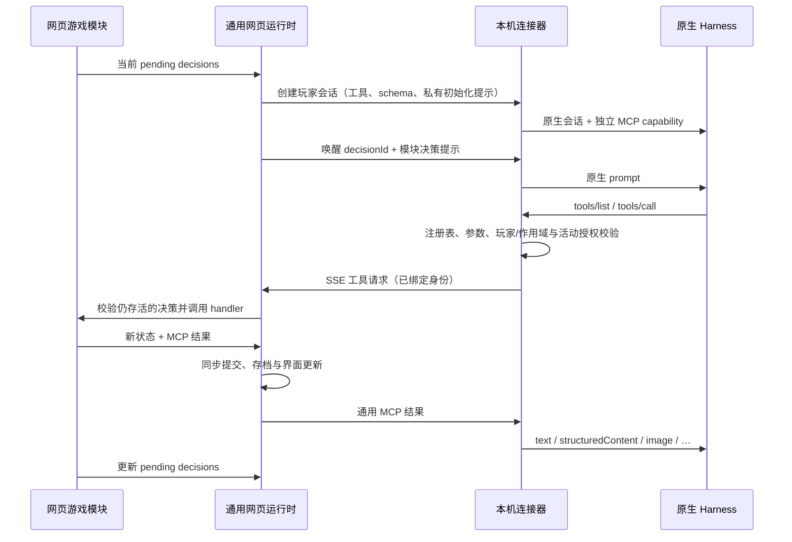

# 架构与数据流

## 四层边界

| 层 | 源码 | 拥有的职责 |
| --- | --- | --- |
| 游戏模块 | `apps/web/src/games/<id>/` | 元数据、人数与配置规则、引擎、私有观察、工具/schema/handler、提示词、完成条件、会话策略、场景/行动/公开记录界面、当前状态格式 |
| 通用网页运行时 | `apps/web/src/controller.ts`、`runtime/types.ts` | 稳定身份、决策调度、串行提交、真人输入、超时、暂停、会话管理和浏览器存档 |
| 独立协议与桥 | `packages/protocol`、`apps/connector/src/{bridge,mcp,server}.ts` | 会话工具注册、JSON Schema 校验、身份/作用域/决策绑定、HTTP/SSE/MCP 转发 |
| Harness | `apps/connector/src/harness/` | 原生进程/会话、模型与强度目录、认证、取消、MCP 挂载及动态工具白名单 |

`packages/game-core` 现在只是共享牌数据、牌堆与规则错误类型；斗地主和德州引擎、规则及测试位于各自模块目录。规则引擎只接收 `human/agent` 控制标记；固定的 Codex/dsh/WorkBuddy 标识属于平台层。

协议、桥和 Harness 都不导入具体游戏。运行时不读取牌、筹码、下注轮或游戏内 revision。中央 App、设置和历史页面通过注册表取得模块界面和摘要，没有逐游戏分支。

网页是权威状态持有者。连接器看不到可执行的模块实现，不下载或运行网页脚本；它只接收声明数据与提示词。用户浏览器与本机 Harness 之间无需云端游戏服务。

公共界面使用 React DOM，菜单与弹窗保留浏览器焦点和键盘语义。大厅由一个 Three.js 绘制器输出玻璃、首屏字形与局部透镜。CPU 光路和 GPU 表面共用几何；GSAP 编排游戏画廊，镭射卡共用 Canvas 绘制源供画面和透镜使用。游戏页保留公共区域透镜，在真人主卡、操作区和棋盘关闭透镜；透镜边缘与折射取样也避开这些区域。所有玩家的状态光效共用 WebGL2 绘制器。

透镜仍只采样鼠标周围 256×256 个 CSS 像素，显示直径为 200 个 CSS 像素。页面合成、卡片中间画布与透镜输出按屏幕像素密度的两倍绘制，最低为 CSS 尺寸的两倍、最高四倍，为接近两倍的透镜放大保留文字和图标边缘。页面纹理使用多级渐远与各向异性过滤，减少透镜边缘压缩细节时的锯齿；采样范围、折射和色散不随绘制分辨率变化。

扑克游戏共用 PlayingCard 的大小两档牌面和 PlayingCardGroup 的悬停波浪效果，游戏模块只补充级牌、逢人配、皇牌等标记。手牌直接放在玩家卡中。

建筑牌、贵族牌等暗色镭射牌面共用 [HolographicCard](holographic-card.md)，璀璨宝石已接入。公共层提供卡面光照、鼠标倾角、等高线或王冠纹路、圆角饰圈、选中边框与透镜绘制；游戏传入配色和卡面内容。外层根元素保持稳定，内层卡面整体倾斜；透镜按相同的卡片平面投影合成，并支持背包面板里的嵌套卡片。所有实例共用一个 WebGL2 上下文，卡面图标通过通用属性同步光照，此组件及其绘制代码不导入游戏模块。

所有 Agent 玩家卡共用 AgentPlayerCard，组件统一绘制头像、姓名、模型信息、资源、手牌区和底栏。状态与本回合动作始终在底部同一行显示，固定预留高度。所有游戏的真人卡共用 HumanPlayerCard，以斗地主的标题、姓名、资源区和底栏为基准；游戏模块提供内容与操作。扑克真人卡通过 HumanPokerPlayerCard 填入完整手牌和选牌操作。

真人玩家的回合提示共用 PlayerTableActions，放在暂停、继续或准备下一局按钮的同一栏左侧。

游戏界面共用 GameLayout。斗地主、掼蛋、保皇共用 PokerTable，按座位显示玩家名、牌型或不出、已出牌，统一牌面尺寸、间距、贡还等阶段提示和结算区域。棋盘、市场等玩法内容通过 GameTable 放入主区。侧栏共用 GameSidebar，只放计分板和 GameActivity 动态卡；顶端对齐公共牌桌，底端对齐主区最后的玩家卡。计分板变长时动态卡相应缩短，记录始终在卡内滚动。

花砖物语、富饶之城和璀璨宝石按可用视口安排公共桌面、玩家信息和当前操作。宽屏下公共桌面横跨主区居中，吸收剩余高度；玩家信息放在下方，真人卡靠左，当前操作利用卡内横向空间展开。真人参与时其他玩家在同一条信息带中排列，空间不足时只滚动这条列表；观战时玩家网格按人数换行。较窄或较矮的窗口通过区域按钮切换公共牌桌、玩家、真人操作与计分动态，页面本身不滚动。玩家信息不分页，玩家卡内部不滚动，也不放固定玩法提示，完整收藏与板面通过背包或详情查看。玩家卡头部和底栏常驻。FoilPanel 面板材质用于玩家、计分板、公开记录和背包，公共桌面容器保持透明，具体玩法牌面由 HolographicCard 等组件绘制。背包使用全屏半透明模糊蒙层，标题在悬浮镭射卡片上方，父容器透明且不绘制边框、阴影或模糊。

璀璨宝石背包的外层面板关闭表面玻璃反光，保留底纹、倾角和卡片自身的镭射光照。布局外壳保持透明，不裁切倾斜卡面；边框和阴影随卡面一起运动，避免露出固定的底板边缘。

国际象棋棋盘直接复用 FoilPanel，与玩家卡共用镭射纹路、平行炫光、鼠标中心光斑和倾斜效果，并开启额外的银色发散炫光。认输常驻在和棋开关同一行，非真人回合禁用，点击直接执行。落子提示放在该行左侧，选中落点后再点该格即可落子。

牌桌下层是独立的三维背景：德州使用带花色纹路的筹码，斗地主、掼蛋和山东保皇共用四种花色，国际象棋使用六种棋子，花砖物语使用五色纹样瓷砖，富饶之城使用无图案的纯色筹码，璀璨宝石使用五种透明切面宝石。棋子、瓷砖与宝石在对应游戏目录实现，纯色筹码由公共 PlainChipModels 提供，各主题由 TableModels 注册和释放。游戏模型只提供视觉几何与材质；公共层在模型创建时取得包含全部子部件变换、倒角和突起的包围盒，向外增加少量余量，再生成一个随刚体旋转的 Box 碰撞体。所有物件均只用 8 个顶点、6 个面，并合并相反的边方向，优先避免穿模，允许形状凹处和尖端附近留有空隙。cannon-es 计算物件之间及边界的刚体碰撞，鼠标作用范围与边界留白也由完整碰撞外壳计算。物件之间有轻微引力，无人推动时会缓缓聚拢；画面横向中央、距顶部 20% 的位置还有柔和的吸引中心，让被推到操作区下方的物件缓缓回到上方，越靠近吸引中心，回引力越弱。

通用背景由 TableSurfaces 提供亮光与哑光材质，按物件序号稳定混排；游戏也可以自行提供材质和灯光，公共层保留其设置。璀璨宝石使用独立的半透明折射材质。通用材质依据 [Lusion 首页脚本](https://lusion.co/_astro/hoisted.CUO_IjfL.js)的 HomeBalloons：亮光粗糙度 0.1，哑光 0.8。本地随网页打包原站的 [512×512 EXR 光照贴图](https://lusion.co/assets/textures/home/matcap.exr)，红通道保存漫反射，绿通道保存哑光高光，蓝通道保存亮光高光；漫反射权重为 0.25 + 0.75×红通道，不增加额外补光。通用材质使用原站的粗糙度修正和 filmic 输出曲线，模型自己的颜色、顶点色和图案贴图继续参与着色。

背景按游戏分别配色。德州保留酒红、宝蓝、象牙、墨绿、深梅紫与琥珀金六色筹码。扑克牌花色使用黑、白、勃艮第红、午夜蓝和松绿五色，颜色与四种形状分别轮换；国际象棋仅使用黑白。这些色值与富饶之城的筹码色值保存在 table-palette.ts 中。花砖直接沿用游戏原色与纹样。璀璨宝石保留游戏的五种宝石色系，不放黄金；动态背景在 table-models.ts 的 CRYSTAL_BODY_COLORS 中为蓝宝石与祖母绿使用更深的本色，独立高光和透明度保持原有设置。富饶之城整块筹码使用同一底色，不加图案、边饰或凸起装饰。静态背景跟随各自游戏的配色与造型。表面明暗由材质光照提供。

参考站关闭了 Three.js 的自动颜色转换；背景着色器将引擎提供的线性底色还原到 sRGB 后再使用参考站的光照与输出曲线，避免重复转换压暗颜色。该处理只作用于背景材质。德州筹码侧边使用独立的 2048×256 环向纹样贴图和 8 倍各向异性采样，曲面由 96 段组成，条纹边缘不经过顶点颜色插值。

光照贴图提供通用物件的环境光与高光，游戏自己的灯光可通过模型集合的 lights 接入场景。所有背景物件关闭阴影投射，保留接收阴影的标记以及材质自身的明暗与高光，不计算物件间的遮蔽；同种基础材质按表面类型共享变体。绘制器使用 NeutralToneMapping，通用材质和宝石材质均设置 toneMapped=false，分别使用自己的输出曲线。背景在光照贴图载入后创建；载入期间保留静态背景，离开页面时释放几何、材质与纹理。WebGL 恢复时重新上传光照数据。

璀璨宝石的三维背景直接复用模块内五种宝石的轮廓与冠面比例，生成冠面、腰棱和底尖；轮廓变化会同步到图标与动态背景。模块内的 crystal.glsl.ts 使用 ShaderMaterial，沿实际切面追踪三次内部折射与反射，并按光程衰减颜色，形成随转动变化的内部亮面。射线同时检查切面边界，保留水滴轮廓尖端的轻微内凹。材质内的有限灯面提供局部反光；切面交界由相邻面的明暗形成，不叠加灰白棱线，没有额外场景补光或物件阴影。背景绘制器启用 MSAA 处理几何边缘；内部折射边界由着色器识别明暗突变，在像素范围内补充四点采样并平滑混合。宝石模型将绘制像素上限设为 250 万，减轻大窗口下的放大锯齿，其他背景仍使用默认的 125 万像素。亮度按最大颜色分量压缩，再转换到屏幕色彩，避免高光压缩使红、绿、蓝泛白。重叠物件通过半透明混合显示后方颜色与轮廓；折射针对宝石内部和灯面，不对后方物件做屏幕空间扭曲。沿用现有物理和鼠标推动，WebGL 不可用时显示五种宝石的半透明静态图案。

鼠标推动按屏幕上的移动路径检测，并向碰到的刚体施加冲量，不受物件所在深度限制。保留浏览器合并的输入采样，在两次物理更新之间也检查整段扫过路径；同一物件每次更新取最强的一次推动，避免高采样率鼠标产生过强的力。按钮、输入和玩家卡片区域不推动背景，透明标题与空白区域可以推动；鼠标停留时也会将靠近的物件轻轻排开。

背景直接绘制到页面的 WebGL 画布，透镜只截取指针周围的区域，不再逐帧复制整个屏幕。物理按 60 Hz 推进，画面跟随屏幕刷新并插值，上限为 60 FPS；限制绘制像素总量与物件数量，聚拢稳定后让刚体休眠并停止背景帧任务。所有通用弹窗（含游戏内背包）通过页面的不可交互状态暂停背景物理和绘制，关闭后从保留的画面继续；弹窗内调整窗口大小时延后更新背景。页面隐藏时暂停，减少动态与静态画面保留当前帧；WebGL 不可用时显示静止花色，卸载时释放几何、材质、纹理和绘制器。

开发模式下，背景画布和 `.cursor-lens` 的 `data-profile` 保存最近 360 个样本的平均耗时、P95 和最大值，每秒更新一次。物理细分为引力、鼠标推动、碰撞筛选、接触检测、约束和求解；绘制细分为变换同步、CPU 提交、GPU 执行及透镜页面合成、取样和拷贝。GPU 时间通过异步计时查询取得，浏览器不支持时明确标记不可用，不以 CPU 提交时间代替。

国际象棋的三维背景由游戏目录内的模型集合提供王、后、车、象、马、兵，每颗棋子以一个覆盖底座和头部的外包盒接入公共物理场景；无 WebGL 时显示对应的棋子字形。游戏操作、棋谱和 Agent 工具共用 chess.js 走子引擎，和棋申请、自动结束与跨局计分由国际象棋模块处理。

## 身份与决策

| 标识 | 生命周期 |
| --- | --- |
| `playerId` | 玩家稳定身份；控制方式、名称或座位变化不改变它 |
| `kind/model/reasoningEffort` | 平台控制设置，不是规则身份 |
| `roomId` | 同一桌/房间；新桌生成新 ID |
| `runId`、`index` | 一手/一局/一轮；由平台生成，领域名称由模块解释 |
| `scopeId` | 会话授权范围，按模块策略取 roomId 或 runId |
| `decisionId` | 模块定义的待完成决策 ID |
| 连接器 `sessionId` | 连接器分配的玩家会话句柄，与上述身份及 Harness 原生会话 ID 独立；重建原生会话时重新分配，增量记录进度随旧会话一起丢弃 |

模块返回决策集合 `{decisionId, actorId, allowedTools?, deadline?}[]`。一个玩家同时只运行一个原生 prompt，不同玩家可以并发。斗地主与德州返回单个行动者；同时决策的游戏可以返回多个参与者。

模块通过移除对应决策表示完成。一个决策可以调用多个工具、修改草案多次再确认；Agent 结束 prompt 后该决策仍存在，平台就暂停并报告未完成。平台没有「必须成功调用恰好一次 game_act」的假设。

工具参数不能提供可切换的玩家、scope 或 decision 身份。桥从 capability 与当前原生任务绑定它们；网页再校验该 actor 的 decision 仍在集合中。模块自己的行动参数可以包括业务 revision，但平台不以全局 revision 使其他并行决策失效。

八款游戏让 Agent 直接提交 `game_act({revision,action})`，行动字段由各模块的 `actions.ts` 声明。初始化提供完整规则和字段说明，当前观察提供自行判断所需的手牌、市场、棋盘、费用和次数等信息；Agent 观察不生成合法行动列表。真人牌桌保留候选生成与操作提示。两个入口调用同一规则引擎，按具体选择校验，不以候选列表是否收录为准；拒绝返回原因，状态和待决策保持不变。

## 串行提交与超时

`handleTool` 和 `humanAction` 是同步状态转换。工具入参校验、存活决策校验、模块计算、MCP 结果/schema 校验和提交之间没有 await；因此并发请求在浏览器事件循环中串行提交。传给工具 handler 的 run 是副本，失败不能修改已发布状态。

状态修改工具必须标记 `requiresDecision:true`，并满足决策的 `allowedTools`。只读工具不能返回新状态；失败结果也不能提交状态。

`deadline` 使用绝对毫秒时间戳。模块提供 `timeout` 时由平台定时调用，也通过同一提交入口更新状态。暂停时不派发超时；恢复后已到期的决策立即处理。默认是现实时间继续流逝，若游戏需要冻结倒计时，应在模块中表达自己的时间规则。超时处理必须使该决策消失或给出未来期限，避免重复触发。

## 会话生命周期

模块声明 `lifecycle.sessionScope`：

- `run`：当前局/手结束关闭会话并撤销 capability，下一局重建。斗地主和德州采用此策略。
- `room`：当前轮结束保留上下文；下一轮同身份、同控制方式、同名称且工具注册表相同的玩家复用会话。改变控制或工具声明只重建受影响的会话。

`eagerAgents:true` 会在首次决策前建立全部 Agent 会话，预先加载身份、规则和工具说明；当前观察在首次消息中发送。懒创建适用于斗地主等顺序游戏。

暂停取消全部活动推理并等待结束；未受中断的会话保留上下文，已中断或失败的消息会使该玩家会话关闭，继续时由网页重新创建。连接器统一限制每条决策为 180 秒，超时先撤销行动权限，再取消上游任务；取消后 5 秒仍未结束则强制关闭。重建使用新的句柄和工具凭据，连接器不再使用旧初始化信息自动恢复会话。旧任务未结束或关闭前，不向该玩家派发下一条消息。

初始化指令只放身份、规则和工具用法。首次决策带当前玩家可见的完整局面与历史；后续消息仍带当前局面，events 只含该会话已确认序号之后的记录，并给出 eventsAfter / eventsThrough。完整历史始终能通过 game_get_state 重读。发送成功后只确认发送快照的截止序号，不能确认发送期间产生的新事件；失败不推进游标。游标只存在内存，绑定实际会话、模型设置和 runId。模型或强度变化时重新创建会话；新 Agent、断线重连、刷新与失败恢复从完整上下文开始。

网页只为 pending 中的决策派发消息，同一玩家串行处理，不同玩家可并发。技能结果随目标玩家下一次正常决策的当前观察与增量记录提供。游戏结束后关闭按局创建的会话，按房间创建的会话可在下一局继续使用。

网页断开、退出连接器或新桌会撤销旧 capability。刷新默认暂停，令牌与可恢复的会话句柄不写进 localStorage，重新开始时建立新原生会话。

连接器从原生错误通知和 ACP 的错误元数据识别上游限流，不把玩家回复或游戏工具结果当作限流信号。限流会取消同一通道的活动决策，并在创建会话、重建会话和发起决策前检查共享冷却。Codex ACP 与 App Server 合并为同一通道，dsh、WorkBuddy 分开。明确的 `Retry-After`、恢复时间或重试延迟优先；没有透传时间时保守冷却 10 分钟。重复的无时间警告不延长等待，后续明确时间可以修正估计或延长已知期限。截止时间写入数据目录的 `cooldowns.json`，不随网页连接或玩家会话结束清除。控制 API 在冷却期间返回 HTTP 429、剩余秒数的 `Retry-After` 和可读提示，沿用网页现有的暂停与继续流程。

原生 Harness 始终使用临时会话，关闭时清理隔离工作目录。连接器通过带 scopeId/playerId 的 conversation 事件回传初始化指令、提示、Agent 回复与可见思考、工具调用与结果、权限答复和错误。网页按局与玩家合并流式片段，写入独立的 localStorage 对话存档，保留当前局与最近 20 条已完成记录。好奇模式只控制展示，不决定记录与会话重建。

观战与好奇模式共用对话面板。面板只隐藏 event 运行日志，其余每条记录分别展示，标明发送方、接收方、中文类型、原始 kind 和时间；工具调用与工具进度也分别保留。错误作为系统记录展示，不推断收发方向。所有条目可单独展开、折叠，正文保留全部字段；消息里的 JSON、代码块和嵌套在字符串中的 JSON 按对象与数组层级渲染。顶部“全部展开／全部折叠”同时控制当前玩家的所有条目和嵌套 JSON，之后仍可逐项调整；新收到的记录也遵循当前展开方式。尚未接收完整或无法解析的内容保留原文。筛选与渲染只作用于面板，本地对话存档保留完整记录。

Windows 的 WinUI 3 启动器用 Job Object 管理本次进程树；macOS 的 SwiftUI 启动器用 Guardian 和租约管道管理进程组。关闭窗口仍在后台运行，退出应用才结束服务与子进程。原生 UI 从私有 JSON 状态事件读取服务、网页与程序检测结果，不解析日志文案。端口处理只对界面确认的具体进程操作，不影响用户独立启动的其他应用。

## 隐私

只有模块知道如何过滤观察。它必须提供玩家与公开记录使用的 `observe(run, playerId|null)`，以及浏览器牌桌专用的 `tableView(run, playerId|null, {revealHands})`。工具结果、初始化提示、决策提示始终使用 observe，不能使用 tableView。

普通私有视图只展示自己的手牌；斗地主叫分不展示底牌，德州正常摊牌只公开未弃牌者。全 Agent 观战时，网页牌桌可查看所有手牌和 Agent 对话，创建对局、玩家设置和页脚均不显示好奇模式开关。真人参与且打开好奇模式时，可随时查看 Agent 对话，整局结束后 revealHands 自动翻开所有余牌；进行中不额外翻牌。牌库、烧牌和叫分底牌仍隐藏。好奇模式偏好保存于平台存档，不进入提示词与工具。每个 Agent 的 MCP URL/capability 不同，工具没有任意 seat 参数。

MCP 的 `readOnlyHint` 等 annotations 仅是说明，授权由 `requiresDecision`、注册表和当前决策决定。dsh/WorkBuddy 的原生白名单从会话声明生成；不会因新游戏增加文件、终端或其他 MCP 权限。
