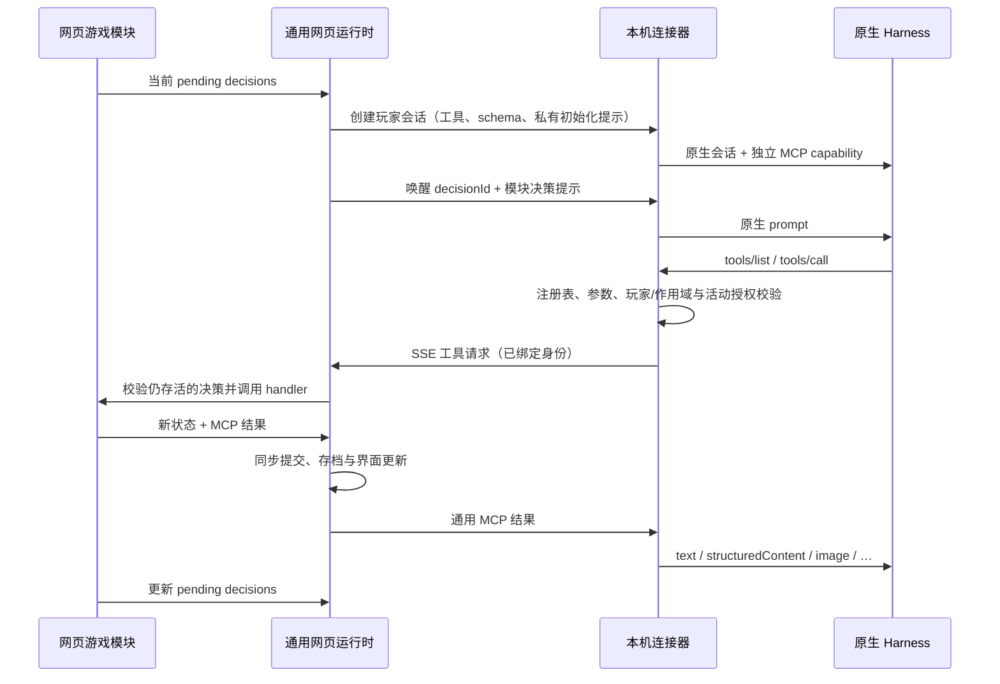

# 架构与数据流

## 四层边界

| 层 | 源码 | 拥有的职责 |
| --- | --- | --- |
| 游戏模块 | `apps/web/src/games/<id>/` | 元数据、人数/队伍与配置规则、引擎、私有观察、工具/schema/handler、提示词、完成条件、会话策略、设置/牌桌/回放界面、当前状态格式 |
| 通用网页运行时 | `apps/web/src/controller.ts`、`runtime/types.ts` | 稳定身份、决策调度、串行提交、真人输入、超时、暂停、会话管理和浏览器存档 |
| 独立协议与桥 | `packages/protocol`、`apps/connector/src/{bridge,mcp,server}.ts` | 会话工具注册、JSON Schema 校验、身份/作用域/决策绑定、HTTP/SSE/MCP 转发 |
| Harness | `apps/connector/src/harness/` | 原生进程/会话、模型与强度目录、认证、取消、MCP 挂载及动态工具白名单 |

`packages/game-core` 现在只是共享牌数据、牌堆与规则错误类型；斗地主和德州引擎、规则及测试位于各自模块目录。规则引擎只接收 `human/agent` 控制标记；固定的 Codex/dsh/WorkBuddy 标识属于平台层。

协议、桥和 Harness 都不导入具体游戏。运行时不读取牌、筹码、下注轮或游戏内 revision。中央 App、设置和历史页面通过注册表取得模块界面和摘要，没有逐游戏分支。

网页是权威状态持有者。连接器看不到可执行的模块实现，不下载或运行网页脚本；它只接收声明数据与提示词。用户浏览器与本机 Harness 之间无需云端游戏服务。

## 身份与决策

| 标识 | 生命周期 |
| --- | --- |
| `playerId` | 玩家稳定身份；控制方式、名称或座位变化不改变它 |
| `kind/model/reasoningEffort` | 平台控制设置，不是规则身份 |
| `roomId` | 同一桌/房间；新桌生成新 ID |
| `runId`、`index` | 一手/一局/一轮；由平台生成，领域名称由模块解释 |
| `scopeId` | 会话授权范围，按模块策略取 roomId 或 runId |
| `decisionId` | 模块定义的待完成决策 ID |
| Harness `sessionId` | 原生进程或线程返回的会话 ID，与上述身份独立 |

模块返回决策集合 `{decisionId, actorId, allowedTools?, deadline?}[]`。一个玩家同时只运行一个原生 prompt，不同玩家可以并发。斗地主与德州返回单个行动者；同时决策的游戏可以返回多个参与者。

模块通过移除对应决策表示完成。一个决策可以调用多个工具、修改草案多次再确认；Agent 结束 prompt 后该决策仍存在，平台就暂停并报告未完成。平台没有「必须成功调用恰好一次 game_act」的假设。

工具参数不能提供可切换的玩家、scope 或 decision 身份。桥从 capability 与当前原生任务绑定它们；网页再校验该 actor 的 decision 仍在集合中。模块自己的行动参数可以包括业务 revision，但平台不以全局 revision 使其他并行决策失效。

## 串行提交与超时

`handleTool` 和 `humanAction` 是同步状态转换。工具入参校验、存活决策校验、模块计算、MCP 结果/schema 校验和提交之间没有 await；因此并发请求在浏览器事件循环中串行提交。传给工具 handler 的 run 是副本，失败不能修改已发布状态。

状态修改工具必须标记 `requiresDecision:true`，并满足决策的 `allowedTools`。只读工具不能返回新状态；失败结果也不能提交状态。

`deadline` 使用绝对毫秒时间戳。模块提供 `timeout` 时由平台定时调用，也通过同一提交入口更新状态。暂停时不派发超时；恢复后已到期的决策立即处理。默认是现实时间继续流逝，若游戏需要冻结倒计时，应在模块中表达自己的时间规则。超时处理必须使该决策消失或给出未来期限，避免重复触发。

## 会话生命周期

模块声明 `lifecycle.sessionScope`：

- `run`：当前局/手结束关闭会话并撤销 capability，下一局重建。斗地主和德州采用此策略。
- `room`：当前轮结束保留上下文；下一轮同身份、同控制方式、同名称且工具注册表相同的玩家复用会话。改变控制或工具声明只重建受影响的会话。

`eagerAgents:true` 会在首次决策前建立全部 Agent 会话，德州用它提供每手起始观察。懒创建适用于斗地主等顺序游戏。

暂停取消全部活动推理并等待结束，保留会话；继续只唤醒尚未完成的决策。网页断开、退出连接器或新桌会撤销旧 capability。刷新默认暂停，原生会话 ID 和令牌不写进 localStorage，重新开始时建立新原生会话。

历史保留开关只决定原生会话是否持久保存，不决定什么时候重建上下文。Windows 的 WinUI 3 启动器用 Job Object 管理本次进程树；macOS 的 SwiftUI 启动器用 Guardian 和租约管道管理进程组。关闭窗口仍在后台运行，退出应用才结束服务与子进程。原生 UI 从私有 JSON 状态事件读取服务、网页与程序检测结果，不解析日志文案。端口处理只对界面确认的具体进程操作，不影响用户独立启动的其他应用。

## 隐私

只有模块知道如何过滤观察。它必须分别为玩家和观众实现 `observe(run, playerId|null)`，并让工具结果、初始化提示、决策提示使用相同私有视图。

斗地主叫分不展示底牌，结束后公开余牌；德州隐藏其他人的底牌、牌库、烧牌与弃牌者底牌，仅在摊牌时展示未弃牌者。每个 Agent 的 MCP URL/capability 不同，工具没有任意 seat 参数。

MCP 的 `readOnlyHint` 等 annotations 仅是说明，授权由 `requiresDecision`、注册表和当前决策决定。dsh/WorkBuddy 的原生白名单从会话声明生成；不会因新游戏增加文件、终端或其他 MCP 权限。
